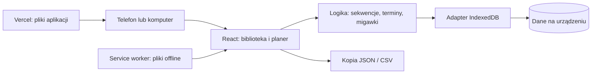

# Architektura i decyzje

## Rekomendacja

Pilates Flow jest statyczną aplikacją PWA z logiką wykonywaną na urządzeniu. Vercel będzie udostępniał gotowe pliki, a przeglądarka będzie zapisywała prywatne plany w IndexedDB. Nie są potrzebne serwer aplikacyjny, konta ani opłacana baza danych.

Do hostingu trafia kod oraz redakcyjny katalog startowy. Grupy, szkice, własne zdjęcia i historia nie są wysyłane przez aplikację do hostingu. Repozytorium kodu i kopia danych aplikacji to dwie różne rzeczy.

## Wybór technologii

| Opcja | Zalety | Koszty i ograniczenia | Decyzja |
|---|---|---|---|
| Sam HTML i JavaScript | Minimalny start | Przy planerze, filtrach, edycji i dialogach szybko rośnie kod ręcznego sterowania UI | Niewybrana |
| Astro | Dobre strony treściowe i HTML, możliwość interaktywnych wysp | Większość tego produktu i tak musiałaby być interaktywna | Nie jest potrzebna dodatkowa warstwa |
| React + Vite + TypeScript | Czytelne komponenty, formularze, typy i statyczny build; możliwość późniejszego opakowania mobilnego | Wymaga procesu budowania | Wybrana |
| Next.js z backendem | Konta i współdzielenie danych | Niepotrzebna złożoność przy lokalnym produkcie | Możliwy osobny etap, jeśli pojawi się potrzeba serwera |

Nie wybieramy frameworka ze względu na samą popularność. Najwięcej pracy w tym produkcie dotyczy zmieniającego się stanu planu i jego trwałości.

## Warstwy

1. **UI:** ekrany, filtry, edytory i dialogi; interfejs po polsku, mobilna dolna nawigacja i menu boczne na komputerze.
2. **Domena:** niezależne typy i walidacja, lokalne daty, generowanie serii, migawki planów, czas i podpowiedzi strukturalne.
3. **Repozytorium danych:** adapter IndexedDB z atomowym zapisem i kontrolą rewizji.
4. **Dystrybucja:** statyczny build Vite, manifest PWA, Workbox, konfiguracja Vercel i CI.

React zarządza prezentacją, nie definicją trwałości danych. W przyszłości adapter można zastąpić SQLite w mobilnym opakowaniu lub dołożyć warstwę synchronizacji. Nie oznacza to, że taka migracja będzie bez pracy: będzie wymagała migracji rekordów, uprawnień i testów na urządzeniach.

## Model danych

| Encja | Najważniejsze dane | Dlaczego |
|---|---|---|
| Exercise | stabilne ID, nazwy, sprzęt, cele, przybory, poziom, etap, czas, opis, kroki, wskazówki, warianty, relacje i obraz | niezależne filtrowanie i kompletna karta ruchu |
| Group | ID, nazwa, sprzęt, poziom, kolor i ogólne wskazówki | dostosowanie zajęć bez przechowywania dokumentacji medycznej uczestników |
| PlanLine | własne ID, migawka ćwiczenia, etap, czas, notatka | ten sam ruch może pojawić się kilka razy, także z różnymi wariantami |
| Draft | lista ruchów i niezapisane jeszcze szczegóły zajęć | powrót do rozpoczętego planu po zamknięciu aplikacji |
| Session | ID, data, godzina, nazwa grupy i jej ID, migawki linii, status i opcjonalne seriesId | stabilna historia i niezależne terminy |
| PlanTemplate | ID, nazwa i migawki linii | ponowne wykorzystanie dobrej sekwencji |
| AppState | wersja schematu, rewizja i kolekcje | atomowy zapis, migracje i spójna kopia |

Katalog bazowy jest częścią kodu. Ćwiczenia własne są osobną kolekcją lokalną; utworzenie własnego wariantu nie zmienia katalogu startowego. Przy zapisaniu zajęć kopiowany jest ich aktualny opis. Późniejsza edycja ćwiczenia nie przepisuje historii.

## Zapis i rozmiar

IndexedDB przechowuje obiekty i obrazy; `localStorage` nie jest odpowiednim magazynem zdjęć. Przy około 200 opisach i umiarkowanej liczbie planów nie ma potrzeby instalowania serwera bazodanowego.

Wersja 1 zapisuje cały dokument stanu w jednej transakcji. To świadomy kompromis dla małej aplikacji osobistej: prosty eksport, odtworzenie i spójność. Zdjęcia zapisane jako data URL powiększają pliki mniej więcej o jedną trzecią; migawki mogą je dodatkowo powielać. Limit zdjęcia to 2 MB, importu 30 MB. To limity aplikacji, nie gwarantowana pojemność przeglądarki.

Jeśli pojawi się wiele dużych zdjęć lub wieloletnia historia, kolejny etap powinien rozdzielić obrazy do osobnego store z odwołaniami i podzielić sesje na rekordy indeksowane datą/grupą. Format kopii należy wtedy migrować. Obecny format ma `schemaVersion: 1`.

Zapisy są kolejkowane. Sukces jest pokazywany dopiero po zakończeniu transakcji. Rewizja uniemożliwia starej karcie nadpisanie nowych danych z innej karty. W razie konfliktu użytkowniczka dostaje komunikat o odświeżeniu. Nie ma automatycznego scalania konkurencyjnych szkiców.

## Kalendarz i powtarzanie

Zajęcia zapisują lokalną datę i godzinę. Używamy arytmetyki kalendarzowej, a nie dodawania 24 godzin w milisekundach ani zamiany lokalnej daty na UTC. Dzięki temu codzienne i tygodniowe serie zachowują dni przez zmianę czasu.

Seria tworzy konkretne wystąpienia do daty końcowej, maksymalnie 366 na jeden zapis. Wszystkie dostają wspólne `seriesId`, ale własne ID i migawki. Użytkowniczka widzi zaplanowane terminy również bez połączenia z internetem. Edycja zmienia jeden termin. Usunięcie oferuje jeden termin albo ten i późniejsze z serii. Zmiana wzorca całej istniejącej serii jest poza wersją 1.

Statusy: zaplanowane, odbyte, odwołane. Samo upłynięcie daty nie oznacza, że zajęcia faktycznie się odbyły.

## Kopie, prywatność i trwałość

Przeglądarka decyduje o limicie miejsca i trwałości. `navigator.storage.persist()` jest prośbą, nie bezwarunkową gwarancją. Dane są przypisane do urządzenia, profilu przeglądarki i originu (protokół + domena + port).

- Eksport JSON obejmuje szkic, grupy, historię, ulubione, własne ćwiczenia, zdjęcia i szablony.
- Import sprawdza wersję, zakresy, daty i typy danych, limit rozmiaru i duplikaty ID.
- Obecny stan jest kopiowany do `before-import` w tej samej transakcji co import; ustawienia oferują jego odtworzenie.
- Znacznik „ostatni eksport” oznacza przekazanie pliku przeglądarce, nie potwierdzenie zapisania go na dysku przez system.
- Kopia nie jest szyfrowana przez aplikację. Należy przechowywać ją we własnej zaufanej lokalizacji.
- Brak logowania oznacza, że osoba z dostępem do odblokowanego profilu przeglądarki ma dostęp do danych.
- Własne ćwiczenia nie stają się automatycznie częścią katalogu na innych urządzeniach.

Przy zmianie domeny należy przed zmianą wyeksportować kopię, a pod nową domeną zaimportować ją. Odinstalowanie lub wyczyszczenie danych może spowodować ich utratę. Jedyną niezależną ochroną przed utratą urządzenia jest kopia poza nim.

## Offline i aktualizacje

Workbox zapisuje pliki gotowej aplikacji w cache. IndexedDB zawiera dane użytkowniczki. Po pierwszym pełnym otwarciu produkcyjnego buildu i aktywacji service workera można używać aplikacji offline. Nowa wersja czeka na świadome odświeżenie; nie przeładowuje formularza automatycznie. Zasoby aplikacji są lokalne, bez zależności od zewnętrznych fontów czy zdjęć.

Sam plik HTML otwarty dwuklikiem nie zastępuje serwera HTTP/HTTPS. Do działania PWA potrzebne jest HTTPS lub lokalny adres localhost.

## Podpowiedzi ruchowe i granice produktu

Podpowiedzi sprawdzają obecność rozgrzewki i zakończenia, porządek etapów, długość planu oraz mieszanie urządzeń. Nie orzekają o klinicznym bezpieczeństwie sekwencji. Relacje „może przygotować do” są redakcyjne i nie stanowią automatycznej kwalifikacji uczestnika.

Instruktorka dobiera powtórzenia, sprężyny i warianty. Nie generujemy zaleceń do konkretnych schorzeń. Nie deklarujemy przeglądu fizjoterapeutycznego, którego nie wykonano. Sugerowanie kategorii jest lokalną regułą słów kluczowych, nie wywołaniem płatnego modelu AI.

## Rozwój do aplikacji mobilnej

1. Zweryfikować codzienną pracę w PWA i uzupełnić katalog do potrzeb instruktorki.
2. Rozdzielić magazyn mediów i rekordy sesji, jeśli potwierdzi się potrzeba większej historii.
3. Dodać opakowanie Capacitor, systemowy wybór plików i ewentualnie SQLite. Zachować logikę domeny i formaty migracji.
4. Dopiero przy wymaganej synchronizacji dołożyć konta, serwer i konflikty zmian. To oddzielny projekt z kosztem utrzymania oraz decyzjami dotyczącymi prywatności.

Nie ma uzasadnienia, by budować od razu konta, subskrypcje, aplikacje sklepowe i analitykę. Najpierw trzeba potwierdzić, że planer faktycznie oszczędza czas podczas pracy.

## Źródła techniczne i kontekst ruchowy

- [Vite — statyczne wdrożenia](https://vite.dev/guide/static-deploy)
- [Vercel — Vite](https://vercel.com/docs/frameworks/frontend/vite)
- [MDN — Storage API](https://developer.mozilla.org/en-US/docs/Web/API/Storage_API)
- [MDN — limity pamięci i usuwanie danych](https://developer.mozilla.org/en-US/docs/Web/API/Storage_API/Storage_quotas_and_eviction_criteria)
- [web.dev — dane offline w PWA](https://web.dev/learn/pwa/offline-data)
- [NHS — informacje bezpieczeństwa przy ogólnych ćwiczeniach pilates](https://www.nhs.uk/live-well/exercise/pilates-and-yoga/osteoporosis-pilates-exercise-video/)

Źródła o pamięci potwierdzają ograniczenia przeglądarek. Materiał NHS uzasadnia rozróżnienie ogólnych ćwiczeń i indywidualnych zaleceń. Nie stanowi weryfikacji naszego katalogu.
